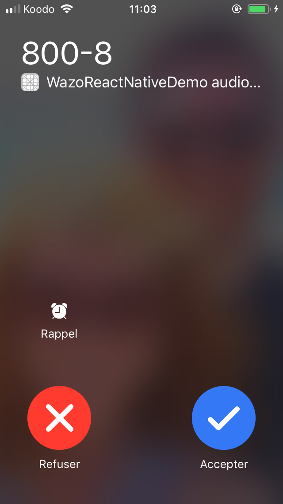
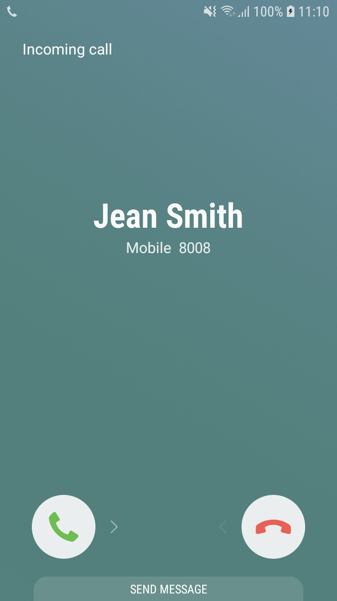

# React Native CallKeep

[](https://www.npmjs.com/package/react-native-callkeep)
[](https://www.npmjs.com/package/react-native-callkeep)
[](https://github.com/react-native-webrtc/react-native-callkeep/actions/workflows/ci.yml)
[](LICENSE)

React Native CallKeep shows your app's VoIP calls in the phone's own call UI: **CallKit** on iOS and **ConnectionService** (Telecom) on Android. Incoming calls ring on the lock screen, calls appear in the system's recents, and the user answers, holds, mutes or hangs up from the system UI.

<p align="center">
  
  &nbsp;&nbsp;&nbsp;
  
</p>

CallKeep handles the call UI and the system integration. The audio and the signaling come from your VoIP stack, for example [react-native-webrtc](https://github.com/react-native-webrtc/react-native-webrtc) or a SIP library.

## Compatibility

| | |
| --- | --- |
| React Native | Tested with 0.87, New Architecture enabled |
| iOS | React Native's minimum (15.1 with 0.87). Calls need a device: the Simulator has no CallKit service. Tested on iOS 26 and 27 |
| Android | Android 6 (API 23) and later; self-managed mode needs Android 8 (API 26). Calls work on emulators. Tested on Android 10 and 16 |
| Expo | With a development build, not Expo Go: see the [Expo guide](docs/guides/expo.md) |

## Installation

```sh
npm install react-native-callkeep
cd ios && pod install
```

Then follow the platform setup: [iOS](docs/ios-installation.md) and [Android](docs/android-installation.md).

## Quick start

```js
import RNCallKeep from 'react-native-callkeep';

await RNCallKeep.setup({
  ios: { appName: 'My App' },
  android: {
    // Shown when the user has to enable the app's phone account.
    alertTitle: 'Permissions required',
    alertDescription: 'This application needs to access your phone accounts',
    cancelButton: 'Cancel',
    okButton: 'OK',
    additionalPermissions: [],
  },
});

// The user answered, from the system call UI or your app.
RNCallKeep.addEventListener('answerCall', ({ callUUID }) => {
  // Connect the call's media, then tell Android the call is active.
  RNCallKeep.setCurrentCallActive(callUUID);
});

// The call ended, from the system call UI or your app.
RNCallKeep.addEventListener('endCall', ({ callUUID }) => {
  // Hang up the call's media.
});

// An incoming call, typically when your server tells the app about one.
// callUUID is a UUID v4 that identifies the call, for example from the `uuid` package.
RNCallKeep.displayIncomingCall(callUUID, '5551234', 'Alice');
```

The [example app](example/) shows every part of the library with simulated calls, on iOS and Android, and explains which file to look at for each part.

## Documentation

- [Setup and options](docs/setup.md)
- [API reference](docs/api.md) and [events](docs/events.md)
- Guides: [incoming calls when the app isn't running](docs/guides/background-calls.md) (VoIP push), [Android self-managed mode](docs/guides/android-self-managed.md), [iOS 27 scene life cycle](docs/guides/ios-scenes.md), [Expo](docs/guides/expo.md)
- [Troubleshooting](docs/troubleshooting.md)
- Migrating from an older major version: [v2 to v3](docs/migration/v2-to-v3.md), [v3 to v4](docs/migration/v3-to-v4.md)
- [Changelog](CHANGELOG.md)

## Contributing

Pull requests, issue reports and suggestions are welcome. See [CONTRIBUTING.md](CONTRIBUTING.md) for how to try a change in an app and what a pull request needs, [SECURITY.md](SECURITY.md) to report a vulnerability privately, and the [Code of Conduct](CODE_OF_CONDUCT.md) that applies to everyone taking part.

## License

This work is dual-licensed under ISC and MIT. Previous work done by @ianlin on iOS is under the ISC license; the rest of the project is under MIT.

`SPDX-License-Identifier: ISC OR MIT`
